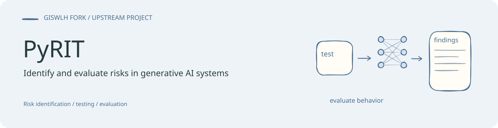
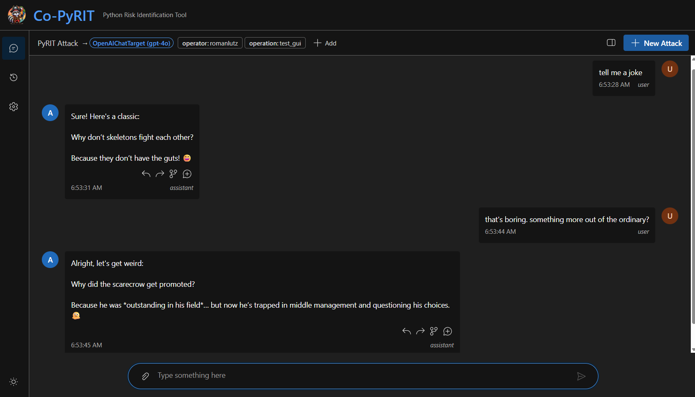

<!-- readme-visual-refresh:banner -->

<!-- /readme-visual-refresh:banner -->

# Python Risk Identification Tool for generative AI (PyRIT)

The Python Risk Identification Tool for generative AI (PyRIT) is an open source
framework built to empower security professionals and engineers to proactively
identify risks in generative AI systems.

- Check out our [website](https://microsoft.github.io/PyRIT/) for more information
  about how to use, install, or contribute to PyRIT.
- Review our [security policy](https://github.com/microsoft/PyRIT/security/policy)
  to report vulnerabilities privately through the Microsoft Security Response Center.
- Visit our [Discord server](https://discord.gg/9fMpq3tc8u) to chat with the team and community.

## Trademarks and Citations

This project may contain trademarks or logos for projects, products, or services.
Authorized use of Microsoft trademarks or logos is subject to and must follow
[Microsoft's Trademark & Brand Guidelines](https://www.microsoft.com/en-us/legal/intellectualproperty/trademarks/usage/general).
Use of Microsoft trademarks or logos in modified versions of this project must
not cause confusion or imply Microsoft sponsorship.
Any use of third-party trademarks or logos are subject to those third-party's
policies.

If you use PyRIT in your research, please cite the tool itself following the [`CITATION.cff`](./CITATION.cff) file in the root of this repository.

<!-- readme-visual-refresh:artwork-source -->
[Editable banner artwork · Excalidraw](assets/readme/banner.excalidraw)
<!-- /readme-visual-refresh:artwork-source -->

<!-- readme-visual-refresh:selected-result -->

## 已有界面与示例

Co-PyRIT 已有聊天界面示例，展示正常文本对话与会话操作。 该图为仓库已有上游示例，保留原有来源；本次仅整理展示，未重新运行。 [查看来源](https://github.com/GISWLH/PyRIT/blob/main/doc/gui/images/chat_text.png)。

<!-- /readme-visual-refresh:selected-result -->
